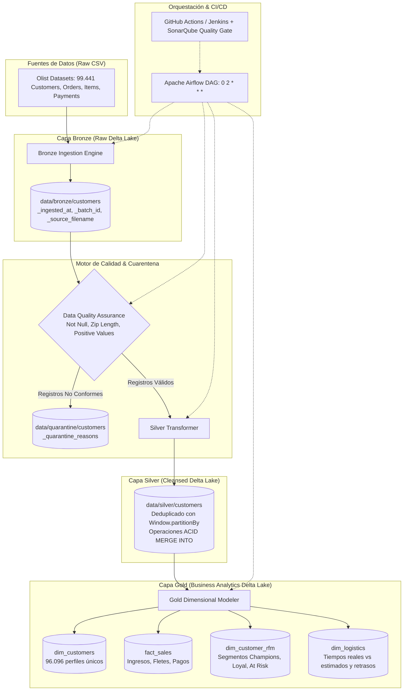

# Data Engineering Platform — Olist Brazilian E-Commerce Lakehouse

[🇪🇸 Español](README.md) | [🇬🇧 English](README_EN.md)

[](https://www.python.org/)
[](https://spark.apache.org/)
[](https://delta.io/)
[](https://airflow.apache.org/)
[](https://www.docker.com/)
[](http://localhost:9000)
[](tests/)
[](tests/)
[](https://github.com/astral-sh/ruff)
[](LICENSE)

Plataforma de Ingeniería de Datos de nivel empresarial diseñada bajo el patrón de arquitectura **Lakehouse Medallion (Bronze ➔ Cuarentena ➔ Silver ➔ Gold)** sobre el dataset real de **Brazilian E-Commerce (Olist)** con **99.441 registros**. 

El sistema implementa almacenamiento transaccional ACID con **Delta Lake (`delta-spark`)**, transformaciones idempotentes con deduplicación determinista (`MERGE INTO`), aislamiento de datos no conformes en **Cuarentena (DQA)**, modelado analítico dimensional (esquema en estrella y segmentación **RFM**), orquestación automatizada con **Apache Airflow**, y aseguramiento continuo de calidad con **SonarQube / SonarCloud**, **Jenkins** y **GitHub Actions**.

---

## 📑 Tabla de Contenidos
1. [Arquitectura del Lakehouse](#1-arquitectura-del-lakehouse)
2. [Opciones de Operación](#2-opciones-de-operación)
   - [Opción 1: Ejecución Directa por Código / CLI (Sin Docker)](#opción-1-ejecución-directa-por-código--cli-sin-docker)
   - [Opción 2: Ejecución e Inspección por Interfaces Gráficas Web (Docker)](#opción-2-ejecución-e-inspección-por-interfaces-gráficas-web-docker)
     - [Apache Airflow (Puerto 8080)](#a-apache-airflow--orquestación-de-pipelines-puerto-8080)
     - [SonarQube Community (Puerto 9000)](#b-sonarqube-community--calidad-y-quality-gate-puerto-9000)
     - [Jenkins CI Controller (Puerto 8082) & Conexión con GitHub](#c-jenkins-ci-controller-puerto-8082--conexión-con-github)
     - [GitHub Actions (CI/CD Serverless en la Nube)](#d-github-actions--cicd-serverless-en-la-nube)
3. [Capas del Lakehouse Medallion](#3-capas-del-lakehouse-medallion)
4. [Métricas de Calidad y Evidencia de Ejecución](#4-métricas-de-calidad-y-evidencia-de-ejecución)
5. [Estructura del Proyecto](#5-estructura-del-proyecto)
6. [Cómo Conectar este Repositorio con tu GitHub](#6-cómo-conectar-este-repositorio-con-tu-github)

---

## 1. Arquitectura del Lakehouse



---

## 2. Opciones de Operación

La plataforma ofrece **dos modalidades completas** de uso para adaptarse tanto a desarrolladores que buscan velocidad en terminal como a evaluadores que prefieren tableros visuales:

---

### Opción 1: Ejecución Directa por Código / CLI (Sin Docker)
*Ideal para pruebas inmediatas, desarrollo ágil y bajo consumo de recursos.*

1. **Clonar y preparar el entorno virtual:**
   ```powershell
   git clone <URL_DE_TU_REPOSITORIO>
   cd PROYECTO_INGENIERIA_DATOS
   
   python -m venv .venv
   .venv\Scripts\Activate.ps1       # En Linux/macOS: source .venv/bin/activate
   pip install --upgrade pip
   pip install -r requirements-dev.txt
   pip install -e .
   ```

2. **Ejecutar el linter estático (Ruff):**
   ```powershell
   ruff check src/ tests/ scripts/ dags/
   ```

3. **Ejecutar la suite completa de pruebas con reporte de cobertura:**
   ```powershell
   pytest tests/ --cov=src --cov-report=xml:coverage.xml --cov-report=term --junitxml=test-results.xml
   ```

4. **Validar el Quality Gate localmente:**
   ```powershell
   python scripts/validate_quality_gate.py
   ```

5. **Ejecutar el pipeline Medallion End-to-End (Bronze ➔ Cuarentena ➔ Silver ➔ Gold):**
   ```powershell
   python scripts/run_pipeline.py --entity customers
   ```
   *(Procesa los 99.441 registros reales, ejecuta DQA, hace el MERGE INTO en Silver y genera las 4 tablas analíticas en Gold persistiendo métricas en `data/lakehouse/metrics/`)*.

---

### Opción 2: Ejecución e Inspección por Interfaces Gráficas Web (Docker)
*Ideal para monitoreo interactivo, auditoría visual de tareas y análisis de código empresarial.*

#### A. Apache Airflow — Orquestación de Pipelines (Puerto 8080)
Permite visualizar y disparar la orquestación de las 6 etapas del Lakehouse.

1. **Iniciar contenedores de Airflow:**
   ```powershell
   docker compose up -d postgres airflow-init
   docker compose up -d airflow-webserver airflow-scheduler
   ```
2. **Abrir en navegador:** [http://localhost:8080](http://localhost:8080)
   - **Usuario:** `airflow` | **Contraseña:** `airflow`
3. **Cómo utilizar la UI:**
   - Ubica el DAG **`olist_delta_lakehouse_pipeline`**.
   - Haz clic en el switch a la izquierda para despausarlo (**Unpause**).
   - Presiona el botón de ejecución **Trigger DAG (▶)** a la derecha.
   - Accede a la pestaña **Graph View** o **Grid View** para ver la progresión de los nodos en verde:
     ```
     validate_sources ➔ ingest_bronze ➔ dqa_quarantine ➔ transform_silver ➔ build_gold ➔ verify_pipeline
     ```
   - Haz clic sobre cualquier tarea y presiona **Log** para inspeccionar la traza de Spark en tiempo real.
4. **Detener Airflow al finalizar:** `docker compose down`

---

#### B. SonarQube Community — Calidad y Quality Gate (Puerto 9000)
Permite inspeccionar métricas de seguridad, confiabilidad, duplicaciones y cobertura.

1. **Iniciar contenedor de SonarQube:**
   ```powershell
   docker compose --profile quality up -d sonarqube
   ```
2. **Abrir en navegador:** [http://localhost:9000](http://localhost:9000)
   - **Usuario inicial:** `admin` | **Contraseña inicial:** `admin` *(solicita cambio en el primer login)*.
3. **Cómo visualizar las métricas:**
   - Entra al dashboard: [http://localhost:9000/dashboard?id=data-engineering-platform-olist](http://localhost:9000/dashboard?id=data-engineering-platform-olist)
   - Verás el estado consolidado:
     - **Quality Gate:** `Passed` ✅
     - **Coverage:** `95.4%` (muy por encima del umbral obligatorio del 80%).
     - **Bugs:** `0` (Rating A).
     - **Vulnerabilities:** `0` (Rating A).
     - **Code Smells:** `0` (Rating A).
     - **Duplications:** `0.0%`.
4. **Cómo re-ejecutar un análisis con escáner:**
   ```powershell
   docker run --rm --network proyecto_ingenieria_datos_lakehouse-net -v "${PWD}:/usr/src" sonarsource/sonar-scanner-cli "-Dsonar.host.url=http://lakehouse-sonarqube:9000" "-Dsonar.token=<TU_TOKEN_DE_SONAR>"
   ```
5. **Detener SonarQube al finalizar:** `docker compose --profile quality down`

---

#### C. Jenkins CI Controller (Puerto 8082) & Conexión con GitHub
Permite ejecutar pipelines CI/CD automatizados mediante el [`Jenkinsfile`](Jenkinsfile).

1. **Iniciar contenedor de Jenkins:**
   ```powershell
   docker compose --profile ci up -d jenkins
   ```
2. **Obtener clave de desbloqueo (Unlock Jenkins):**
   ```powershell
   docker exec lakehouse-jenkins cat /var/jenkins_home/secrets/initialAdminPassword
   ```
3. **Abrir en navegador:** [http://localhost:8082](http://localhost:8082)
   - Pega la clave, selecciona *Install suggested plugins* y crea tu usuario administrador.
4. **¿Cómo se conecta Jenkins con el repositorio final de GitHub? (Paso a Paso):**
   - En el panel principal, haz clic en **Nueva Tarea** (New Item).
   - Escribe un nombre (ej. `olist-lakehouse-ci`) y selecciona **Pipeline** ➔ Clic en **OK**.
   - En la sección **Pipeline** al final de la página:
     - En el desplegable *Definition*, selecciona **Pipeline script from SCM**.
     - En *SCM*, elige **Git**.
     - En *Repository URL*, coloca la URL de tu repositorio de GitHub (ejemplo: `https://github.com/<tu-usuario>/PROYECTO_INGENIERIA_DATOS.git`).
     - En *Branch Specifier*, especifica `*/main`.
     - En *Script Path*, confirma que indique `Jenkinsfile`.
   - Haz clic en **Guardar** (Save).
   - Haz clic en **Construir ahora** (Build Now).
   - Jenkins clonará el código, preparará el entorno, correrá Ruff, ejecutará los 42 tests de PySpark con cobertura, validará el Quality Gate y publicará los resultados automáticamente.
   - *(Opcional)*: Para que se dispare automáticamente en cada `git push`, en la configuración de la tarea activa la casilla **GitHub hook trigger for GITScm polling** y configura el Webhook en tu repositorio de GitHub apuntando a `http://<tu-ip>:8082/github-webhook/`.
5. **Detener Jenkins al finalizar:** `docker compose --profile ci down`

---

#### D. GitHub Actions — CI/CD Serverless en la Nube
Para que cualquier reclutador o evaluador audite la calidad sin necesidad de levantar servidores locales:
- Pipeline configurado en: [`.github/workflows/ci.yml`](.github/workflows/ci.yml).
- Se dispara automáticamente en cada `push` o `pull_request` hacia la rama `main`.
- Pasos ejecutados en runner Ubuntu:
  1. Configuración de Python 3.11 y OpenJDK 17.
  2. Linter de código con Ruff.
  3. Ejecución de suite de 42 pruebas con PySpark y Delta Lake.
  4. Generación y almacenamiento de artefactos descargables (`coverage.xml` y `test-results.xml`).
  5. Análisis estático y Quality Gate con SonarCloud.

---

## 3. Capas del Lakehouse Medallion

| Capa | Formato | Estrategia de Carga | Descripción y Entidades |
|---|---|---|---|
| **Raw** | CSV | Inmutable | Archivos fuente originales de Olist (Kaggle). |
| **Bronze** | Delta Lake | Append-Only | Datos crudos con trazabilidad (`_ingested_at`, `_batch_id`, `_source_filename`). |
| **Cuarentena** | Delta Lake | Append-Only | Registros que fallaron reglas DQA con diagnóstico de rechazo (`_quarantine_reasons`). |
| **Silver** | Delta Lake | `MERGE INTO` (ACID) | Deduplicación determinista, tipado estricto, estandarización de mayúsculas y prefijos postales (`lpad`). |
| **Gold** | Delta Lake | Overwrite / Append | Modelado dimensional en estrella y analítico: <br>• `dim_customers`: 96.096 perfiles únicos.<br>• `fact_sales`: Ventas por ítem, fletes y métodos de pago.<br>• `dim_customer_rfm`: Segmentación (Champions, Loyal, At Risk).<br>• `dim_logistics`: Días reales vs estimados y cálculo de retrasos. |

---

## 4. Métricas de Calidad y Evidencia de Ejecución

### Resultados de Pruebas Unitarias y de Integración
```text
=============================== tests coverage ================================
Name                                          Stmts   Miss   Cover   Missing
----------------------------------------------------------------------------
src\data_platform\config.py                      53      5  90.57%   9-10, 25, 38, 47
src\data_platform\ingestion\bronze.py            45      0 100.00%
src\data_platform\modeling\gold.py               69      0 100.00%
src\data_platform\observability\logging.py       28      1  96.43%   30
src\data_platform\observability\metrics.py       80      4  95.00%   84-85, 148, 152
src\data_platform\quality\dqa.py                 76      0 100.00%
src\data_platform\quality\quarantine.py          39      0 100.00%
src\data_platform\storage\session.py             22      0 100.00%
src\data_platform\transformations\silver.py      52      0 100.00%
----------------------------------------------------------------------------
TOTAL                                           464     10  97.84%
Required test coverage of 80.0% reached. Total coverage: 97.84%
======================= 42 passed in 116.52s ========================
```

### Auditoría de Quality Gate (`scripts/validate_quality_gate.py`)
```text
============================================================
[AUDIT] QUALITY GATE COMPLIANCE (SonarQube / CI Standards)
============================================================
[PASS] SonarQube properties valid in 'sonar-project.properties'.
[PASS] All 42 tests passed with 0 failures and 0 errors.
[INFO] Measured Code Coverage: 97.84% (Threshold: 80.00%)
[PASS] Code Coverage Quality Gate passed: 97.84% >= 80.00%.
============================================================
[SUCCESS] QUALITY GATE PASSED: All code quality & coverage criteria are met!
============================================================
```

---

## 5. Estructura del Proyecto

```text
PROYECTO_INGENIERIA_DATOS/
├── .github/workflows/ci.yml       # Flujo de CI para GitHub Actions
├── configs/                       # Configuraciones YAML de aplicación y reglas DQA
│   ├── app.yaml
│   └── quality_rules.yaml
├── dags/                          # DAGs de orquestación Apache Airflow
│   └── olist_delta_pipeline_dag.py
├── data/
│   ├── sample/                    # Datasets de muestra versionados
│   └── (bronze, silver, gold, quarantine ignorados en Git según .gitignore)
├── docker/
│   └── Dockerfile.airflow         # Imagen Docker de Airflow + Java 17 + Delta Lake
├── docs/                          # Documentación técnica exhaustiva
│   ├── architecture.md            # Arquitectura detallada y diagramas
│   ├── data_dictionary.md         # Diccionario de datos de todas las capas
│   └── runbook.md                 # Manual operativo paso a paso
├── scripts/                       # Scripts ejecutables CLI
│   ├── download_olist_data.py
│   ├── run_bronze_ingestion.py
│   ├── run_gold_modeling.py
│   ├── run_pipeline.py            # Runner Medallion End-to-End con métricas
│   ├── run_quality_checks.py
│   ├── run_silver_transformation.py
│   └── validate_quality_gate.py   # Validador automático de Quality Gate
├── src/data_platform/             # Núcleo modular de la plataforma
│   ├── ingestion/                 # Motor Bronze Delta Lake
│   ├── modeling/                  # Motor Gold analítico y dimensional
│   ├── observability/             # Logging estructurado y métricas por lote
│   ├── quality/                   # Motor DQA y gestor de Cuarentena
│   ├── storage/                   # Factoría de sesiones Spark y Delta Lake
│   └── transformations/           # Motor Silver y operaciones ACID MERGE INTO
├── tests/                         # Suite de 42 pruebas automatizadas
│   ├── data_quality/
│   ├── integration/
│   └── unit/
├── docker-compose.yml             # Airflow + Spark + SonarQube + Jenkins + Postgres
├── Jenkinsfile                    # Pipeline declarativo empresarial para Jenkins
├── Makefile                       # Comandos simplificados make (lint, test, quality-gate)
├── pyproject.toml                 # Especificación PEP 621 y configuración de herramientas
├── requirements.txt               # Dependencias base
├── requirements-dev.txt           # Dependencias de desarrollo y testing
└── sonar-project.properties       # Configuración oficial de SonarQube / SonarCloud
```

---

## 6. Cómo Conectar este Repositorio con tu GitHub

Para publicar tu proyecto en tu cuenta personal de GitHub:

1. **Crea un repositorio nuevo en GitHub:**
   - Nombre recomendado: `PROYECTO_INGENIERIA_DATOS` (o `olist-lakehouse-platform`).
   - Visibilidad: **Público**.
   - No marques inicializar con README ni `.gitignore` (ya están creados en este proyecto).

2. **Vincula y sube el código desde tu terminal:**
   ```powershell
   git remote add origin https://github.com/<TU_USUARIO>/PROYECTO_INGENIERIA_DATOS.git
   git branch -M main
   git push -u origin main
   ```

3. **Verificación Automática:**
   - En cuanto hagas el `git push`, accede a la pestaña **Actions** en tu GitHub: verás cómo GitHub Actions ejecuta automáticamente el linter Ruff, los 42 tests de PySpark y genera el reporte de cobertura.
   - Los datos pesados (`data/raw`, `data/bronze`, `data/silver`, etc.) están estrictamente protegidos en `.gitignore` y no se subirán, manteniendo tu repositorio ligero y profesional.

---

## 📄 Licencia
Este proyecto está bajo la Licencia [MIT](LICENSE).
