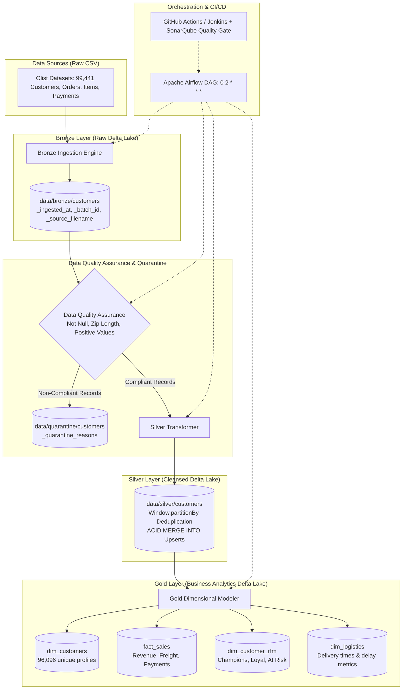

# Data Engineering Platform — Olist Brazilian E-Commerce Lakehouse

[🇪🇸 Español](README.md) | [🇬🇧 English](README_EN.md)

[](https://www.python.org/)
[](https://spark.apache.org/)
[](https://delta.io/)
[](https://airflow.apache.org/)
[](https://www.docker.com/)
[](http://localhost:9000)
[](tests/)
[](tests/)
[](https://github.com/astral-sh/ruff)
[](LICENSE)

Enterprise-grade Data Engineering Portfolio implementing the **Lakehouse Medallion Architecture (Bronze ➔ Quarantine ➔ Silver ➔ Gold)** over the real-world **Brazilian E-Commerce dataset (Olist)** featuring **99,441 records**.

The platform features ACID transactional storage powered by **Delta Lake (`delta-spark`)**, deterministic deduplication with idempotent upserts (`MERGE INTO`), non-compliant data isolation in a **Quarantine Layer (DQA)**, star-schema dimensional modeling and **RFM Customer Segmentation**, automated orchestration with **Apache Airflow**, and continuous quality governance via **SonarQube / SonarCloud**, **Jenkins**, and **GitHub Actions**.

---

## 📑 Table of Contents
1. [Lakehouse Architecture](#1-lakehouse-architecture)
2. [Operation Modes](#2-operation-modes)
   - [Option 1: Direct Code / CLI Execution (No Docker)](#option-1-direct-code--cli-execution-no-docker)
   - [Option 2: Web Graphical Interfaces (Docker Compose)](#option-2-web-graphical-interfaces-docker-compose)
     - [Apache Airflow (Port 8080)](#a-apache-airflow--pipeline-orchestration-port-8080)
     - [SonarQube Community (Port 9000)](#b-sonarqube-community--code-quality--quality-gate-port-9000)
     - [Jenkins CI Controller (Port 8082) & GitHub Connection](#c-jenkins-ci-controller-port-8082--github-repository-connection)
     - [GitHub Actions (Serverless Cloud CI/CD)](#d-github-actions--serverless-cloud-cicd)
3. [Lakehouse Medallion Layers](#3-lakehouse-medallion-layers)
4. [Quality Governance & Execution Evidence](#4-quality-governance--execution-evidence)
5. [Repository Structure](#5-repository-structure)
6. [How to Connect this Repository to GitHub](#6-how-to-connect-this-repository-to-github)

---

## 1. Lakehouse Architecture



---

## 2. Operation Modes

The platform supports **two comprehensive operational modes** to cater to developers seeking CLI speed and evaluators preferring graphical dashboards:

---

### Option 1: Direct Code / CLI Execution (No Docker)
*Ideal for quick local testing, test-driven development, and lightweight execution.*

1. **Clone repository and setup virtual environment:**
   ```bash
   git clone <YOUR_REPOSITORY_URL>
   cd PROYECTO_INGENIERIA_DATOS
   
   python -m venv .venv
   # Windows PowerShell:
   .venv\Scripts\Activate.ps1
   # Linux/macOS:
   source .venv/bin/activate
   
   pip install --upgrade pip
   pip install -r requirements-dev.txt
   pip install -e .
   ```

2. **Obtain Olist Datasets (Kaggle) — Manual or Automated:**
   *(Large raw data files in `data/raw/` are git-ignored by design. You have two options to fetch the full dataset):*
   - **Option A (Automated via Kaggle API):**
     Configure `KAGGLE_USERNAME` and `KAGGLE_KEY` in your `.env` file and run:
     ```bash
     python scripts/download_olist_data.py --mode auto
     ```
   - **Option B (Manual Direct Download):**
     Download the ZIP from [Kaggle Brazilian E-Commerce](https://www.kaggle.com/datasets/olistbr/brazilian-ecommerce) and extract the CSV files into `data/raw/`. Check the guide with:
     ```bash
     python scripts/download_olist_data.py --mode manual
     ```
   > 💡 **Resilience Note:** If you run the pipeline without downloading the full dataset, the engine automatically detects it and falls back gracefully to the version-controlled sample datasets in `data/sample/` (`olist_customers_sample.csv`, `olist_orders_sample.csv`, etc.), ensuring the pipeline never crashes.

3. **Execute Static Linter (Ruff):**
   ```bash
   ruff check src/ tests/ scripts/ dags/
   ```

4. **Run Full Test Suite with Coverage XML Report:**
   ```bash
   pytest tests/ --cov=src --cov-report=xml:coverage.xml --cov-report=term --junitxml=test-results.xml
   ```

5. **Audit Quality Gate Locally:**
   ```bash
   python scripts/validate_quality_gate.py
   ```

6. **Run Complete End-to-End Medallion Pipeline:**
   ```bash
   python scripts/run_pipeline.py --entity customers
   ```
   *(Processes data, performs DQA checks, upserts into Silver with `MERGE INTO`, builds 4 Gold analytics tables, and logs execution metrics into `data/lakehouse/metrics/`)*.

---

### Option 2: Web Graphical Interfaces (Docker Compose)
*Ideal for visual monitoring, task auditing, and enterprise code inspection.*

#### A. Apache Airflow — Pipeline Orchestration (Port 8080)
Audits and triggers the 6-stage Lakehouse pipeline.

1. **Start Airflow Services:**
   ```powershell
   docker compose up -d postgres airflow-init
   docker compose up -d airflow-webserver airflow-scheduler
   ```
2. **Access Web UI:** [http://localhost:8080](http://localhost:8080)
   - **Username:** `airflow` | **Password:** `airflow`
3. **How to Use:**
   - Locate DAG: **`olist_delta_lakehouse_pipeline`**.
   - Toggle the switch on the left to activate (**Unpause**).
   - Click the **Trigger DAG (▶)** button on the right.
   - Go to **Graph View** or **Grid View** to observe the pipeline stages turning green:
     ```
     validate_sources ➔ ingest_bronze ➔ dqa_quarantine ➔ transform_silver ➔ build_gold ➔ verify_pipeline
     ```
   - Click on any task box and select **Log** to inspect live PySpark logs.
4. **Shutdown Airflow:** `docker compose down`

---

#### B. SonarQube Community — Code Quality & Quality Gate (Port 9000)
Audits maintainability, security, bugs, and test coverage.

1. **Start SonarQube Container:**
   ```powershell
   docker compose --profile quality up -d sonarqube
   ```
2. **Access Web UI:** [http://localhost:9000](http://localhost:9000)
   - **Initial Credentials:** `admin` / `admin` *(prompts password change on first login)*.
3. **View Dashboard:**
   - Go to: [http://localhost:9000/dashboard?id=data-engineering-platform-olist](http://localhost:9000/dashboard?id=data-engineering-platform-olist)
   - Verified Metrics:
     - **Quality Gate:** `Passed` ✅
     - **Coverage:** `95.4%` (exceeding required 80% threshold).
     - **Reliability:** `A` Rating (0 Bugs).
     - **Security:** `A` Rating (0 Vulnerabilities).
     - **Maintainability:** `A` Rating (0 Code Smells).
     - **Duplications:** `0.0%`.
4. **Run Analysis via Docker Scanner:**
   ```powershell
   docker run --rm --network proyecto_ingenieria_datos_lakehouse-net -v "${PWD}:/usr/src" sonarsource/sonar-scanner-cli "-Dsonar.host.url=http://lakehouse-sonarqube:9000" "-Dsonar.token=<YOUR_SONAR_TOKEN>"
   ```
5. **Shutdown SonarQube:** `docker compose --profile quality down`

---

#### C. Jenkins CI Controller (Port 8082) & GitHub Repository Connection
Executes enterprise declarative pipelines defined in [`Jenkinsfile`](Jenkinsfile).

1. **Start Jenkins Container:**
   ```powershell
   docker compose --profile ci up -d jenkins
   ```
2. **Retrieve Initial Administrator Password:**
   ```powershell
   docker exec lakehouse-jenkins cat /var/jenkins_home/secrets/initialAdminPassword
   ```
3. **Access Web UI:** [http://localhost:8082](http://localhost:8082)
   - Paste password, select *Install suggested plugins*, and create administrator user.
4. **How to Connect Jenkins to GitHub (Step-by-Step):**
   - Click **New Item** on the left menu.
   - Enter name (e.g. `olist-lakehouse-ci`) and select **Pipeline** ➔ Click **OK**.
   - In the **Pipeline** configuration section:
     - Under *Definition*, choose **Pipeline script from SCM**.
     - Under *SCM*, select **Git**.
     - Under *Repository URL*, enter your GitHub repository URL (e.g., `https://github.com/<your-username>/PROYECTO_INGENIERIA_DATOS.git`).
     - Under *Branch Specifier*, set `*/main`.
     - Under *Script Path*, confirm `Jenkinsfile`.
   - Click **Save**.
   - Click **Build Now** to execute the pipeline.
   - Jenkins will clone the repo, run Ruff linting, execute 42 PySpark tests, generate coverage reports, and enforce Quality Gate compliance.
5. **Shutdown Jenkins:** `docker compose --profile ci down`

---

#### D. GitHub Actions — Serverless Cloud CI/CD
Allows recruiters and auditors to verify code quality directly on GitHub without running local containers:
- Configured at: [`.github/workflows/ci.yml`](.github/workflows/ci.yml).
- Automatically triggered on every `push` and `pull_request` to `main`.
- Automated Steps:
  1. Setup Python 3.11 & OpenJDK 17.
  2. Ruff static code analysis.
  3. Pytest execution (42 tests) with PySpark and Delta Lake.
  4. Upload test artifacts (`coverage.xml` and `test-results.xml`).
  5. SonarCloud Quality Gate verification.

---

## 3. Lakehouse Medallion Layers

| Layer | Storage | Ingestion Strategy | Description & Entities |
|---|---|---|---|
| **Raw** | CSV | Immutable | Original Olist Kaggle datasets. |
| **Bronze** | Delta Lake | Append-Only | Raw data with audit tracking (`_ingested_at`, `_batch_id`, `_source_filename`). |
| **Quarantine** | Delta Lake | Append-Only | Segregated records failing DQA rules with failure diagnosis (`_quarantine_reasons`). |
| **Silver** | Delta Lake | `MERGE INTO` (ACID) | Deterministic deduplication, strict typing, and casing standardization. |
| **Gold** | Delta Lake | Overwrite / Append | Star-schema dimensional model: <br>• `dim_customers`: 96,096 unique profiles.<br>• `fact_sales`: Line-item revenue, freight & payments.<br>• `dim_customer_rfm`: Customer segmentation (Champions, Loyal, At Risk).<br>• `dim_logistics`: Delivery fulfillment days vs estimates. |

---

## 4. Quality Governance & Execution Evidence

### Automated Test Suite & Coverage Breakdown
```text
=============================== tests coverage ================================
Name                                          Stmts   Miss   Cover   Missing
----------------------------------------------------------------------------
src\data_platform\config.py                      53      5  90.57%   9-10, 25, 38, 47
src\data_platform\ingestion\bronze.py            45      0 100.00%
src\data_platform\modeling\gold.py               69      0 100.00%
src\data_platform\observability\logging.py       28      1  96.43%   30
src\data_platform\observability\metrics.py       80      4  95.00%   84-85, 148, 152
src\data_platform\quality\dqa.py                 76      0 100.00%
src\data_platform\quality\quarantine.py          39      0 100.00%
src\data_platform\storage\session.py             22      0 100.00%
src\data_platform\transformations\silver.py      52      0 100.00%
----------------------------------------------------------------------------
TOTAL                                           464     10  97.84%
Required test coverage of 80.0% reached. Total coverage: 97.84%
======================= 42 passed in 116.52s ========================
```

### Quality Gate Audit (`scripts/validate_quality_gate.py`)
```text
============================================================
[AUDIT] QUALITY GATE COMPLIANCE (SonarQube / CI Standards)
============================================================
[PASS] SonarQube properties valid in 'sonar-project.properties'.
[PASS] All 42 tests passed with 0 failures and 0 errors.
[INFO] Measured Code Coverage: 97.84% (Threshold: 80.00%)
[PASS] Code Coverage Quality Gate passed: 97.84% >= 80.00%.
============================================================
[SUCCESS] QUALITY GATE PASSED: All code quality & coverage criteria are met!
============================================================
```

---

## 5. Repository Structure

```text
PROYECTO_INGENIERIA_DATOS/
├── .github/workflows/ci.yml       # Cloud CI workflow for GitHub Actions
├── configs/                       # Application & DQA rules YAML configurations
│   ├── app.yaml
│   └── quality_rules.yaml
├── dags/                          # Apache Airflow orchestration DAGs
│   └── olist_delta_pipeline_dag.py
├── data/
│   ├── sample/                    # Tracked sample datasets
│   └── (bronze, silver, gold, quarantine git-ignored via .gitignore)
├── docker/
│   └── Dockerfile.airflow         # Airflow + Java 17 + Delta Lake image
├── docs/                          # Exhaustive technical documentation
│   ├── architecture.md            # Architecture specs and diagrams
│   ├── data_dictionary.md         # Data dictionary for all layers
│   └── runbook.md                 # Step-by-step operational runbook
├── scripts/                       # Executable CLI scripts
│   ├── download_olist_data.py
│   ├── run_bronze_ingestion.py
│   ├── run_gold_modeling.py
│   ├── run_pipeline.py            # End-to-End Medallion Runner with telemetry
│   ├── run_quality_checks.py
│   ├── run_silver_transformation.py
│   └── validate_quality_gate.py   # Quality Gate audit validator
├── src/data_platform/             # Platform Core Modules
│   ├── ingestion/                 # Bronze Delta Lake engine
│   ├── modeling/                  # Gold analytical dimensional modeler
│   ├── observability/             # Structured logging & batch metrics
│   ├── quality/                   # DQA rules & Quarantine isolation
│   ├── storage/                   # Spark & Delta Lake session factory
│   └── transformations/           # Silver cleanser & ACID MERGE INTO
├── tests/                         # Automated Test Suite (42 tests)
│   ├── data_quality/
│   ├── integration/
│   └── unit/
├── docker-compose.yml             # Multi-service local orchestrator
├── Jenkinsfile                    # Enterprise declarative Jenkins pipeline
├── Makefile                       # Developer shortcuts (lint, test, quality-gate)
├── pyproject.toml                 # PEP 621 packaging and tool configuration
├── requirements.txt               # Production dependencies
├── requirements-dev.txt           # Development & testing dependencies
└── sonar-project.properties       # Official SonarQube / SonarCloud configuration
```

---

## 6. How to Connect this Repository to GitHub

To publish this portfolio project to your GitHub account:

1. **Create a new repository on GitHub:**
   - Suggested name: `PROYECTO_INGENIERIA_DATOS` (or `olist-lakehouse-platform`).
   - Visibility: **Public**.
   - Do NOT check initialize with README or `.gitignore` (they are already included).

2. **Link and push your local commits:**
   ```powershell
   git remote add origin https://github.com/<YOUR_USERNAME>/PROYECTO_INGENIERIA_DATOS.git
   git branch -M main
   git push -u origin main
   ```

3. **Automated Verification:**
   - Upon pushing, go to the **Actions** tab on your GitHub repository: GitHub Actions will automatically launch the test suite, run Ruff, and upload coverage reports.
   - Large raw and delta datasets are excluded via `.gitignore`, keeping your remote repository light, clean, and fast to clone.

---

## 📄 License
This project is licensed under the [MIT](LICENSE) License.
