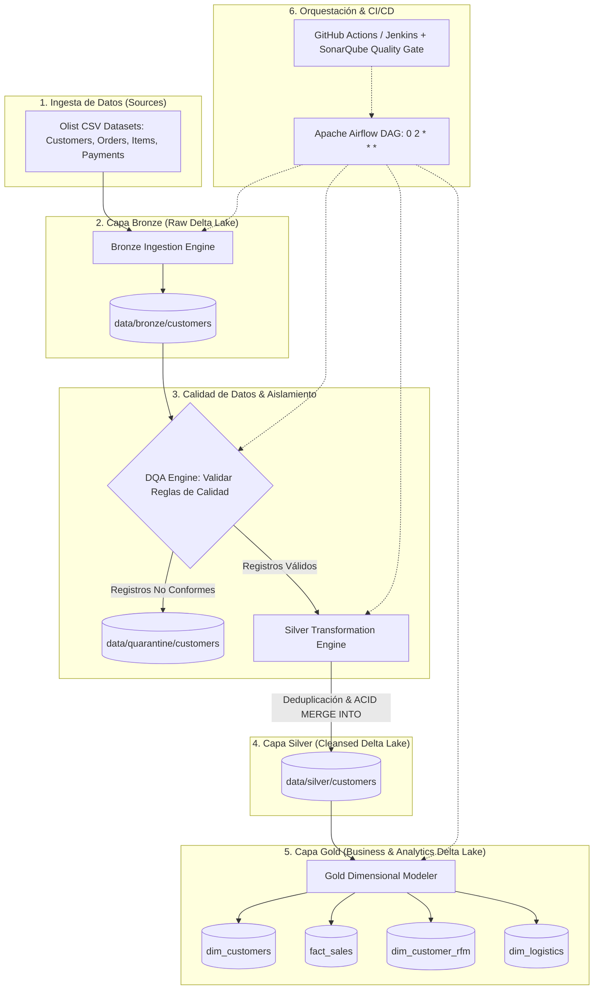
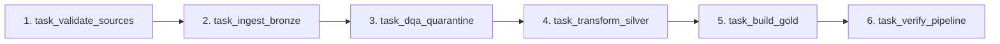

# Arquitectura de Datos — Lakehouse Medallion (Olist E-Commerce)

Este documento detalla la arquitectura técnica, los patrones de diseño y los componentes que integran la plataforma de datos Lakehouse Medallion implementada con **PySpark**, **Delta Lake**, **Apache Airflow**, **SonarQube** y **Docker**.

---

## 1. Diagrama de Arquitectura Global

---

## 2. Principios de Diseño Arquitectónico

### 2.1 Patrón Medallion Multi-Capa
- **Bronze (Raw Zone):** Ingesta append-only de los datos de origen preservando la fidelidad del archivo original. Se enriquecen con metadatos de auditoría: `_ingested_at`, `_batch_id` y `_source_filename`.
- **Cuarentena (Quarantine Isolation):** Los registros que no satisfacen las reglas DQA (longitud de código postal, valores nulos, reglas de positividad) son segregados antes de llegar a Silver con un diagnóstico explícito (`_quarantine_reasons`), permitiendo reprocesamiento posterior sin corromper la analítica.
- **Silver (Cleansed Zone):** Almacén normalizado, fuertemente tipado y deduplicado determinísticamente usando ventanas (`Window.partitionBy`). Los cambios y nuevos registros se integran mediante operaciones ACID `MERGE INTO` de Delta Lake, garantizando idempotencia.
- **Gold (Curated Zone):** Modelos dimensionales (estrella) y analíticos (segmentación RFM y métricas logísticas) persistidos en tablas Delta optimizadas para consultas analíticas y BI.

### 2.2 Garantías ACID e Idempotencia
Gracias al motor transaccional de Delta Lake:
- **Lecturas consistentes:** Sin efectos de "lectura sucia" durante cargas masivas concurrentes.
- **Time Travel:** Posibilidad de auditar y consultar versiones históricas en `_delta_log/`.
- **Upserts atómicos:** La combinación de `whenMatchedUpdateAll()` y `whenNotMatchedInsertAll()` asegura que una ejecución repetida del pipeline no duplique información.

---

## 3. Matriz Tecnológica

| Componente | Tecnología | Versión | Rol en la Plataforma |
|---|---|---|---|
| **Motor de Procesamiento** | Apache Spark (PySpark) | `3.5.9` | Procesamiento distribuido en memoria de lotes grandes |
| **Almacenamiento Transaccional** | Delta Lake (`delta-spark`) | `3.2.1` | Almacén de tablas con transacciones ACID y `MERGE INTO` |
| **Orquestador de Pipelines** | Apache Airflow | `2.8.2` | Planificación, dependencias de tareas y reintentos automáticos |
| **Calidad de Código y SAST** | SonarQube Community | `26.11` | Inspección estática, detección de vulnerabilidades y Quality Gate |
| **Contenerización** | Docker & Docker Compose | `27.x` | Aislamiento y reproducibilidad de servicios |
| **Base de Datos de Metadatos** | PostgreSQL | `15-alpine` | Backend transaccional para Airflow |
| **Framework de Pruebas** | Pytest + pytest-cov | `9.x` / `7.x` | Suite de 39+ pruebas unitarias y de integración |
| **Linter & Formateador** | Ruff | `0.1.x` | Análisis estático ultrarrápido de estándares PEP8/Python |
| **Automatización CI/CD** | GitHub Actions & Jenkins | Latest | Ejecución continua de lint, tests y reporte de métricas |

---

## 4. Pipeline de Orquestación Airflow

El DAG [`olist_delta_lakehouse_pipeline`](../dags/olist_delta_pipeline_dag.py) orquesta la ejecución en 6 pasos secuenciales:

- **Programación:** Cron diario a las 02:00 UTC (`0 2 * * *`).
- **Tolerancia a fallos:** 2 reintentos automáticos con retardo exponencial de 2 minutos.
- **Guard Standalone:** La lógica puede ejecutarse con o sin Airflow instalado gracias a la abstracción en `scripts/run_pipeline.py`.
